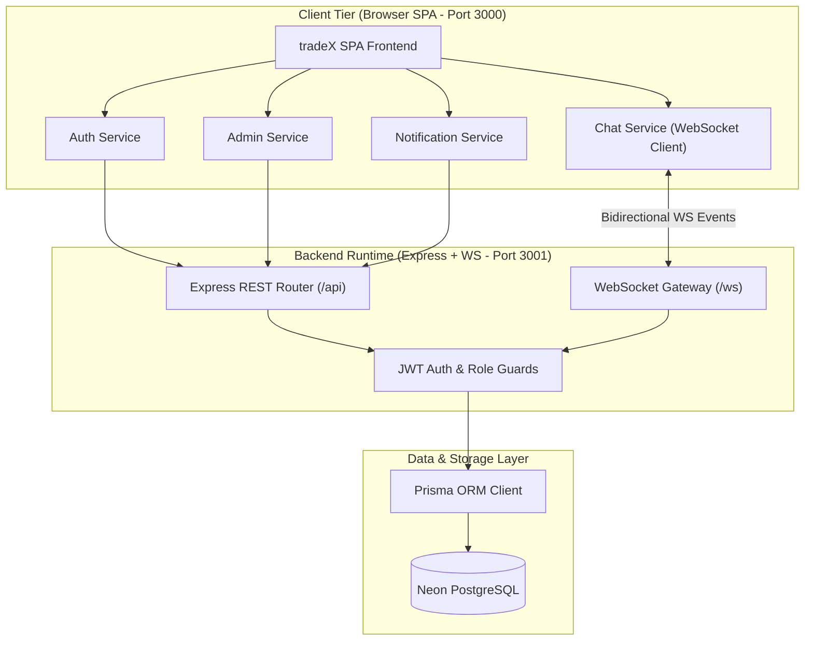

# tradeX Platform Engineering Handoff: Authentication, Real-Time Messaging & Administration

**Project:** tradeX Campus Marketplace (Version 1.0)  
**Target Environment:** University Campus Network (Mekelle University)  
**Modules Covered:** Authentication, Student Identity Verification, Real-Time Chat & Safety Zones, Notifications, Admin Console  
**Status:** 100% Implemented, Verified & Merged into `main`  
**Last Updated:** 2026-11-19  

---

## 1. Executive Architecture Overview

The tradeX platform architecture unifies three primary functional tiers:
1. **Frontend Client (Vite 8 + TypeScript SPA):** Responsive user interface with dual-mode operational capabilities (offline simulation fallback vs. live production backend).
2. **Backend Services (Express 5 REST API):** High-throughput modular API mounted on port `3001` enforcing strict JWT authentication, role guards (`STUDENT`, `ADMIN`, `SUPERADMIN`), and the canonical response envelope.
3. **Real-Time Gateway (Native WebSocket Server):** Persistent bidirectional event gateway mounted at `ws://localhost:3001/ws` powering live messaging, typing indicators, notification dispatch, and verification status synchronization.



---

## 2. Canonical Response Envelope

All REST endpoints adhere strictly to the standardized envelope:

### Success Response
```json
{
  "data": { ... } | [ ... ],
  "error": null,
  "meta": {
    "timestamp": "2026-11-19T16:46:06.580Z",
    "total": 4
  }
}
```

### Error Response
```json
{
  "data": null,
  "error": {
    "code": "UNAUTHORIZED",
    "message": "Authentication token required."
  },
  "message": "Authentication token required.",
  "meta": {
    "timestamp": "2026-11-19T16:46:06.580Z"
  }
}
```

*Note: For single-resource responses, attributes are also spread at the root object level to maintain full backwards compatibility with legacy client selectors.*

---

## 3. Subsystem Specifications & Operational Contracts

### 3.1 Authentication & Student Identity (`/api/auth`)

| Endpoint | Method | Access | Description |
| :--- | :--- | :--- | :--- |
| `/api/auth/register` | `POST` | Public | Registers a university student; sends email verification OTP. |
| `/api/auth/login` | `POST` | Public | Authenticates credentials; returns JWT session token and `AuthUser`. |
| `/api/auth/verify-email` | `POST` | Public | Validates 6-digit OTP code against registration session. |
| `/api/auth/resend-otp` | `POST` | Public | Re-generates 6-digit verification code with 60-second cooldown. |
| `/api/auth/verification-status` | `GET` | Authenticated | Fetches current student verification tier and badge. |
| `/api/auth/logout` | `POST` | Authenticated | Invalidates session and clears active tokens. |

#### Key Technical Enforcements:
- 6-digit OTP input interface (`#verify-otp-screen`) supports automatic character forwarding, backspace traversal, and paste event sanitation.
- Active countdown timer set to 5 minutes (`05:00`) with tabular numeric font spacing.

---

### 3.2 Student ID Document Verification (`/api/verification`)

| Endpoint | Method | Access | Description |
| :--- | :--- | :--- | :--- |
| `/api/verification/upload-id` | `POST` | Authenticated | Uploads student ID photo; sets status to `PENDING_APPROVAL`. |
| `/api/verification/status` | `GET` | Authenticated | Returns current approval status, rejection details, and profile data. |

#### Interoperability Note:
`POST /api/verification/upload-id` accepts either `idDocument` or `idDocumentDataUrl` in the JSON request body. Upon upload, user state immediately updates to `PENDING_APPROVAL` with `0% Student Tier` eligibility pending administrative review.

---

### 3.3 Real-Time Chat & Campus Safe Exchange Zones (`/api/chat`, `/api/conversations`)

| Endpoint | Method | Access | Description |
| :--- | :--- | :--- | :--- |
| `/api/chat/conversations` | `GET` | Authenticated | Lists conversations sorted by `lastMessageAt` desc (also mounted at `/api/conversations`). |
| `/api/chat/conversations` | `POST` | Authenticated | Initiates or returns existing conversation for a target listing ID. |
| `/api/chat/conversations/:id/messages` | `GET` | Authenticated | Retrieves chronological message thread with sender metadata. |
| `/api/chat/conversations/:id/messages` | `POST` | Authenticated | Sends a message; triggers real-time WebSocket broadcast to participants. |
| `/api/chat/meetup-spots` | `GET` | Public | Returns verified university safe exchange zones. |

#### Official Verified Campus Safe Exchange Zones:
1. **Main Library Plaza (North Entrance)** — High visibility, open quadrangle with security CCTV coverage.
2. **Student Union Lounge (Ground Floor)** — Monitored indoor daytime safe zone with campus Wi-Fi.
3. **Campus Gate 1 Security Checkpoint** — Highest security level with 24/7 armed guard pavilion (recommended for electronics/valuables).
4. **Central Campus Cafeteria Entrance** — High foot-traffic gathering point during peak lunch and afternoon hours.

---

### 3.4 WebSocket Gateway Protocols (`/ws`)

The real-time gateway is hosted at `ws://localhost:3001/ws`.

#### Connection Lifecycle:
1. **Connection Initiation:** Client establishes raw WebSocket connection; receives `{ event: "connected", connectionId: string }`.
2. **Authentication:** Client transmits:
   ```json
   { "type": "auth", "token": "<JWT_TOKEN>" }
   ```
3. **Channel Subscription:** Client subscribes to private discussion or user notification channels:
   ```json
   { "type": "subscribe", "channel": "private-chat-<conversationId>" }
   { "type": "subscribe", "channel": "private-user-<userId>" }
   ```
4. **Typing Relay:**
   ```json
   { "type": "typing", "conversationId": "<conversationId>", "isTyping": true }
   ```
5. **Inbound Broadcast Events Received by Client:**
   - `new-message`: Delivers incoming chat message to active chat view.
   - `typing`: Toggles peer animated typing indicator dots.
   - `new-notification`: Triggers navbar badge increment and notification drawer alert.
   - `verification-updated`: Dynamically flips student verification badge (`APPROVED` / `REJECTED`) without page reload.

---

### 3.5 In-App Notifications Drawer (`/api/notifications`)

| Endpoint | Method | Access | Description |
| :--- | :--- | :--- | :--- |
| `/api/notifications` | `GET` | Authenticated | Lists up to 50 recent notifications and unread counter. |
| `/api/notifications/:id/read` | `POST` / `PATCH` | Authenticated | Marks a specific notification as read. |
| `/api/notifications/read-all` | `POST` | Authenticated | Marks all unread alerts for current user as read. |

---

### 3.6 Administrative Moderation Console (`/api/admin`)

*All administrative endpoints require `UserRole` of `ADMIN` or `SUPERADMIN`.*

| Endpoint | Method | Description |
| :--- | :--- | :--- |
| `/api/admin/summary` | `GET` | Aggregated dashboard metrics: pending verifications, active students, open reports, total listings. |
| `/api/admin/verifications` | `GET` | Verification review queue (also mounted at `/api/admin/verifications/pending`). |
| `/api/admin/verifications/:id/approve` | `POST` | Approves student ID, updates user to `APPROVED`, broadcasts socket event, logs audit trail. |
| `/api/admin/verifications/:id/reject` | `POST` | Rejects ID with required reason string, broadcasts socket event, logs audit trail. |
| `/api/admin/students` | `GET` | Queryable student registry supporting name/ID filter and status filtering. |
| `/api/admin/students/:id/status` | `PATCH` | Administrative account status update (`APPROVED`, `SUSPENDED`, `REJECTED`). |
| `/api/admin/reports` | `GET` | Open moderation reports filed by campus users. |
| `/api/admin/reports/:id/resolve` | `POST` | Resolves report (`REMOVE_LISTING`, `WARN_USER`, `SUSPEND_USER`, `DISMISS`). |
| `/api/admin/audit-logs` | `GET` | Chronological immutable log of all reviewer actions. |

---

## 4. Pre-Seeded Accounts for Testing

| Role | Email | Password | Permissions |
| :--- | :--- | :--- | :--- |
| **Verified Student** | `student@mu.edu.et` | `Password123!` | Create listings, chat, propose safe meetups, 0% commission tier. |
| **Campus Admin** | `admin@mu.edu.et` | `AdminSecret2026!` | Access Split-Review Console, review IDs, suspend accounts, moderate listings. |

---

## 5. Automated Verification Results

| Test Suite | Execution Command | Result | Details |
| :--- | :--- | :--- | :--- |
| **Full Lifecycle Journey Test** | `npm test` | **17/17 Passed** | Validates Register $\rightarrow$ OTP $\rightarrow$ ID Upload $\rightarrow$ Admin Review $\rightarrow$ Notification $\rightarrow$ Chat Meetup. |
| **Backend REST Endpoints** | `npm run test:dev3` | **14/14 Passed** | Tests all verification, chat, meetup, admin, and notification routes. |
| **Real-Time WebSocket Gateway** | `npm run test:realtime` | **6/6 Passed** | Validates socket handshake, JWT auth, channel routing, typing indicators, and broadcasts. |
| **Static TypeScript Compilation**| `npm run lint` | **0 Errors** | Zero type errors across frontend and backend codebase (`tsc --noEmit`). |
| **Production Build** | `npm run build` | **0 Errors** | Production Vite SPA bundle generated cleanly (136ms). |
